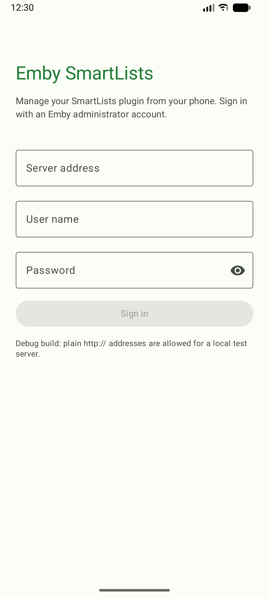
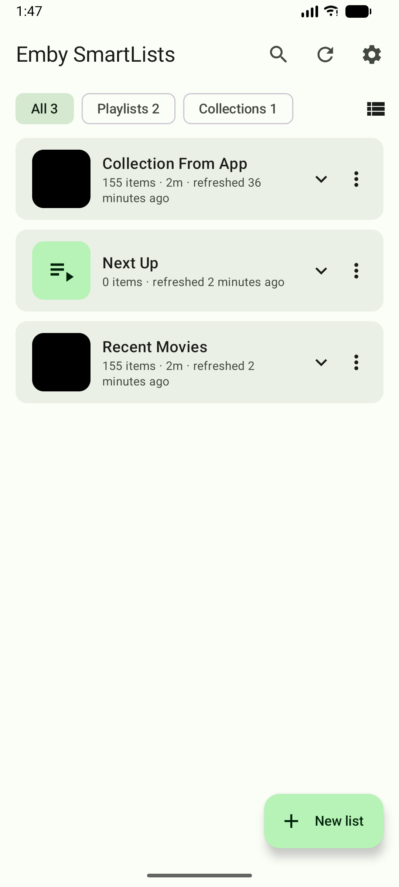
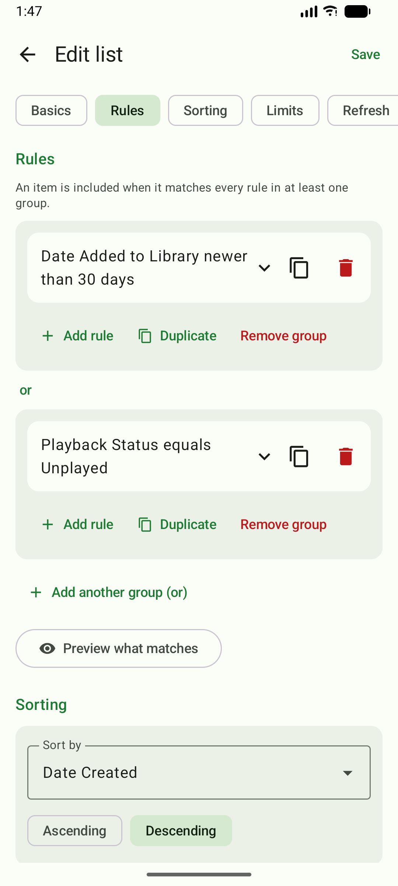
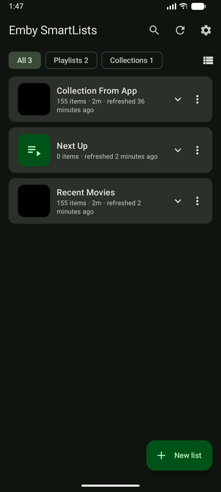

# Emby SmartLists (Android)

An Android app for managing the [SmartLists plugin](https://github.com/feerlessleadr/emby.smartlists) on your Emby Server from your phone. It talks to the plugin's HTTP API ([docs/api.md](https://github.com/feerlessleadr/emby.smartlists/blob/main/docs/api.md)); it is an administrator tool, so you sign in with an Emby administrator account.

<p>
  
  
  
  
</p>

## Status

Early version (0.4.x). What works today:

- Sign in (Emby administrator account), with a check that the SmartLists plugin is installed and speaks a compatible API version.
- See all your smart lists (playlists and collections), how many items they hold and when they were last refreshed, and read their rules, sorting, limits and auto-refresh in plain words.
- Refresh a list or all lists, enable or disable a list, delete a list (optionally with its Emby playlist/collection).
- **Create and edit lists:** start from a template (Next Up, Continue Watching) or blank; choose playlist or collection, media types, rules (groups of rules, with inputs that fit each field: libraries as tick boxes, dates, relative dates, yes/no, fixed choices), up to three sorts (including the round-robin sorts), limits and auto-refresh. The rule fields, conditions and sorts come from your server's plugin, so they always match it.
- **Everything else the web page's list form offers:** playlists for several users or for every user (and public); refresh schedules and show/hide schedules; sort title, description, tags and favorite on the Emby list; custom images (from the phone's photo picker, existing lists); bumpers; advanced options (extras, match by items, group into collections, pick one group at random, "similar to" comparison); and per-rule options (check for a specific user, include items with no date, runtime unit, only the default audio track, look at the parent series/album, collection search depth). Collections can change whose watch state they use.
- **Everyday comfort:** rules fold to one readable sentence; copy a rule, a rule group or a whole list; a prompt before leaving unsaved changes; section shortcuts above the form; **preview what a list would contain** before saving (needs plugin 0.1.10); delete with a few seconds to **undo**; search and filter chips (type, disabled, failed); progress and failure of refreshes on the cards; cover art; compact or comfortable cards; a colour mark per list.
- **Share and import** a list as text; **backups** (back up now, restore, save a copy, delete); a **home-screen widget** and a **quick-settings tile** that refresh all lists.
- **Settings:** light, dark or follow the phone; an accent colour (eight swatches, or your wallpaper colours on Android 12+); card density; backups; see who you are signed in as and sign out.

Not in the app: external lists and the end-user (non-administrator) page, which the plugin does not offer on Emby either. Settings the app does not know about are kept as they are when you save.

## Requirements

- Emby Server 4.10.1 or newer with the **SmartLists plugin 0.1.9 or newer** ([releases](https://github.com/feerlessleadr/emby.smartlists/releases)); 0.1.10 or newer for the preview.
- An Emby **administrator** account.
- A server address that uses **HTTPS** with a certificate your phone trusts (for example Let's Encrypt). The app refuses plain `http://` addresses and does not trust user-installed certificates.
- Android 8.0 (API 26) or newer.

## Install

The app is installed from this repository's releases, not from the Play Store.

**With [Obtainium](https://obtainium.imranr.dev/) (recommended, updates itself):** in Obtainium choose *Add App*, enter `https://github.com/feerlessleadr/emby.smartlists.android` and add it. Obtainium installs the APK from the latest release and offers updates.

**By hand:** download `Emby-SmartLists-<version>.apk` from the [latest release](https://github.com/feerlessleadr/emby.smartlists.android/releases/latest) and open it on your phone (Android asks you to allow installs from your browser or file manager).

## Security

- The password is sent to your Emby server once, over HTTPS, to get an access token. Only the token is kept on the phone, encrypted with a key in the Android Keystore. The token is sent in a request header, never in a URL.
- Release builds cannot make plain HTTP connections at all (Android network security configuration), and trust only the system's certificate authorities.
- The token belongs to an administrator and can do what an administrator can do in the plugin. Sign out in the app (top right) to forget it; you can also revoke the device in Emby (Dashboard, Devices).
- If your server is reachable only over a VPN such as WireGuard, keep the VPN connected and use the address that resolves inside it.

## Build from source

You need JDK 17 or newer and the Android SDK (platform 37). Android Studio provides both.

```powershell
./gradlew.bat test            # unit tests
./gradlew.bat assembleDebug   # debug APK: app/build/outputs/apk/debug
```

The debug build (application id `com.feerlessleadr.embysmartlists.debug`) also allows plain HTTP so it can be tried against a local test server, for example the emulator's host at `http://10.0.2.2:8096`. Release builds never do.

## Releasing

Write `docs/releases/vX.Y.Z.md`, push it, then push the tag `vX.Y.Z`. The GitHub workflow runs the tests, builds the APK signed with the project's release key and publishes it as the release's only asset. A real release needs the repository secrets `SIGNING_KEYSTORE_BASE64`, `SIGNING_STORE_PASSWORD`, `SIGNING_KEY_ALIAS` and `SIGNING_KEY_PASSWORD`; without them the workflow refuses to publish. Run it from the Actions tab for a dry run that publishes nothing. Android only accepts an update signed with the same key as the installed app, so keep the release key safe.

## About this project

This app was written exclusively with Claude (Anthropic's AI model, through Claude Code) at the direction of the repository owner, not by hand. It was tested on an emulator against a test Emby server and by its unit tests, but not audited. It comes with no warranty (see the license). If you are not comfortable with that, do not use it. It is an unofficial tool and is not affiliated with Emby.

It works with the [SmartLists plugin for Emby](https://github.com/feerlessleadr/emby.smartlists), which is itself a port of the Jellyfin SmartLists plugin by [jyourstone](https://github.com/jyourstone/jellyfin-smartlists-plugin) (itself inspired by ankenyr's SmartPlaylist plugin).

## License

[MIT](LICENSE)
